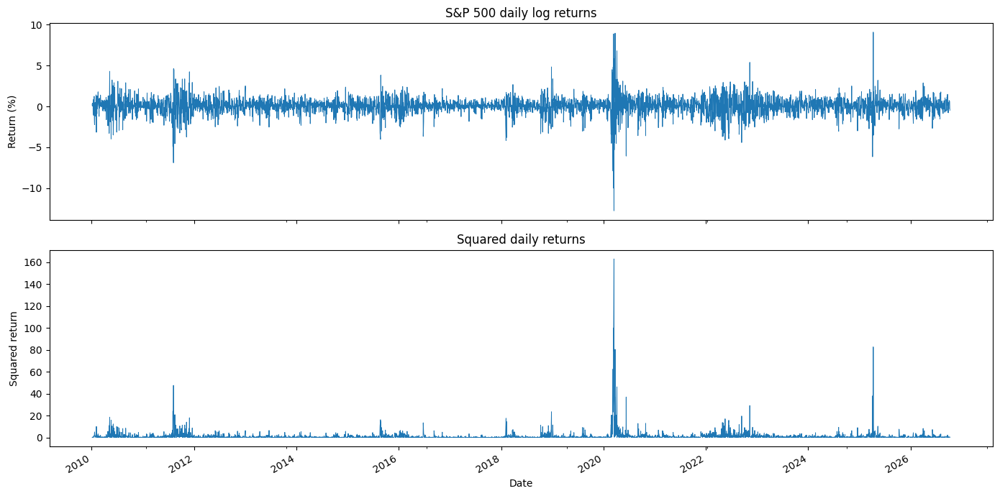
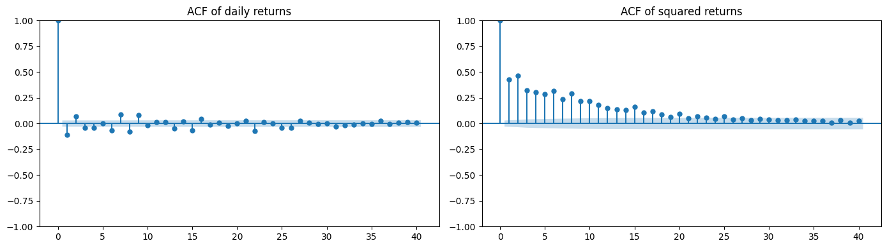
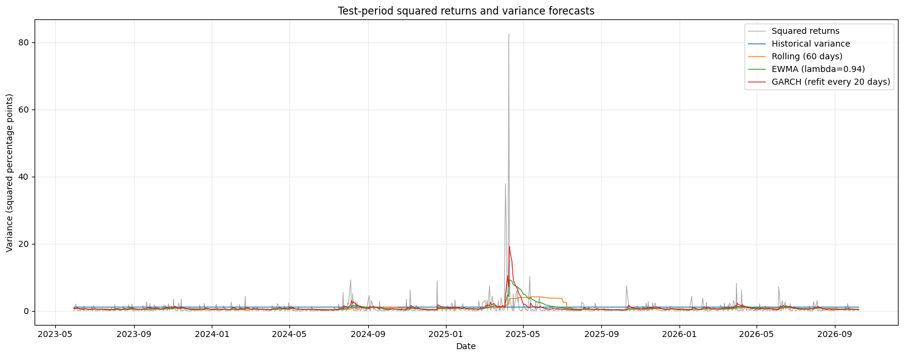
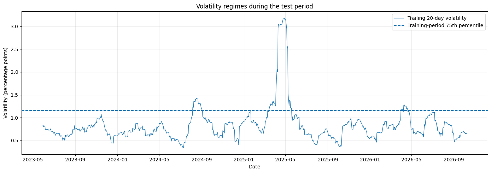

## The question: can volatility be predicted?

The weak-form **Efficient Market Hypothesis (EMH)** suggests that stock prices reflect the information contained in their historical prices and returns. If this holds, strategies based solely on past price movements should not consistently generate abnormal returns. However, this does not necessarily mean that every feature of returns is unpredictable.

Consider two questions: can we predict whether the market will go up or down tomorrow? And can we predict how much it will move? These are different problems. Even if the direction of returns is difficult to forecast, patterns in the magnitude of market movements might still provide useful information about future risk.

This leads to the main question: **Can patterns in historical returns help us forecast future volatility?**

> Code: You can explore the <a href="https://github.com/laurasalop03/research-blog/blob/main/research/01-volatility-clustering/volatility_clustering.ipynb" target="_blank" rel="noopener noreferrer">Jupyter notebook on GitHub</a> to see the data analysis, forecasting models and evaluation.

## The first clue: volatility clustering

As shown in @fig-returns, daily S&P 500 returns alternate between relatively calm periods and periods with much larger fluctuations. This is known as **volatility clustering**. It suggests that the magnitude of market movements may have some persistence, even when the direction of individual returns is difficult to anticipate.

{#fig-returns width=100% fig-alt="Two stacked time-series charts from 2010 to 2026: S&P 500 daily log returns in percent (top) and squared daily returns (bottom). Both are mostly calm with occasional bursts of large movements, the largest in early 2020, when returns fall to about minus 13 percent and squared returns reach about 160, with smaller bursts in 2011 and 2025."}

To see whether this pattern also appears in the statistical properties of returns, I compared the *autocorrelation* of daily returns with that of squared returns in @fig-acf. Autocorrelation measures how strongly observations in a time series are related to their past values. In this case, it helps us examine whether past returns, or past squared returns, are associated with current values. The distinction matters: returns describe the direction and size of a market movement, while squared returns place more emphasis on the magnitude of that movement.

{#fig-acf width=100% fig-alt="Two autocorrelation plots for lags 1 to 40 with a shaded confidence band. For daily returns (left), the autocorrelations are small, mostly near zero, with a few slightly outside the band. For squared returns (right), they start at about 0.4 to 0.45 at the first lags and decay slowly, staying above the band for many lags."}

The two autocorrelation plots show a contrast: daily returns have relatively weak autocorrelation, while squared returns show stronger persistence at early lags. This is consistent with the idea that the magnitude of market movements contains information about its recent history.

To check this formally, I ran a *Ljung-Box test* on the earliest part of the data (the fitting period described below). It tests whether the first 10 autocorrelations are jointly zero. The test rejects "no autocorrelation" for squared returns, as expected (statistic 3419.4, p-value effectively zero). It also rejects it for raw returns (statistic 237.6, p ≈ 2 × 10⁻⁴⁵), so the weak autocorrelation in returns is small but not exactly zero.

That second result does not by itself contradict the weak-form EMH. Small but statistically significant autocorrelation is common in daily index returns, and one frequently cited cause is that the 500 stocks in the index do not all trade at the same moment. More importantly, the EMH is about whether past prices allow consistent abnormal profits, and a significant test statistic does not show that. I did not test that question here.

It is an encouraging first clue, but not yet evidence that a forecasting model will perform well. To investigate that, we need to test how accurately different models can predict future volatility using data they have not seen before.

## The experiment: four forecasting approaches

Seeing volatility clustering is one thing, but finding out whether it can actually help forecast future volatility is another. To investigate this, I compared four forecasting approaches using daily S&P 500 data.

I used daily closing prices from January 2010 to October 2026 and calculated log returns, expressed in percentage points. The idea was to see whether different ways of using past market movements could provide useful information about future variance.

Throughout this experiment, I use the terms *volatility* and *variance*. They are closely related, but not exactly the same: volatility is the standard deviation of returns, while variance is the square of that standard deviation. Since the forecasting models used here estimate variance, I focus on variance forecasts when comparing their performance. Both describe how much returns fluctuate, just on different scales.

### Making the comparison fair

I split the data chronologically, using the earliest observations to fit the models, a later period to select their settings and the final period for testing.

This distinction matters because a model can perform well on data it has already seen. By keeping the test period separate from model selection, I could evaluate how the approaches performed on observations that had not been used to choose their settings.

### Four ways to forecast variance

I compared four approaches, ranging from a simple historical benchmark to a model that captures changes in variance over time.

- **Historical variance:** a simple benchmark based on historical market variability. It provides a reference point for judging whether more sophisticated approaches add value.
- **Rolling variance:** estimates variance using a moving window of recent returns. Older observations eventually drop out, allowing the estimate to adapt as market conditions change.
- **Exponentially weighted moving average (EWMA):** gives more weight to recent returns and progressively less weight to older observations. This allows the estimate to respond to new market movements without discarding older information abruptly.
- **GARCH(1,1):** models variance as a combination of a baseline level, the latest squared return and the previous variance estimate. This lets the model capture volatility persistence explicitly.

The approaches differ mainly in how they use the past. The rolling model considers a fixed window, EWMA gradually reduces the influence of older observations and GARCH models how new shocks and previous values contribute to the next variance estimate.

### How did I evaluate the forecasts?

Since the true conditional variance of the market is not directly observable, I used **squared returns as a proxy**. However, squared returns are noisy: a single day's movement can differ substantially from the underlying variance, even though squared returns provide information about it over time.

Strictly speaking, a squared return also contains the squared mean return, and the models treat the mean differently: GARCH estimates a constant mean (about 0.08% per day), the rolling variance subtracts the average of its window and EWMA assumes a mean of zero. Since the squared mean is only about 0.006, these differences have a very small effect on the comparison.

I compared the forecasts using two loss functions: **mean squared error (MSE)** and **quasi-likelihood loss (QLIKE)**. Both measure the difference between the forecast variance and the squared-return proxy, but they penalize forecast errors differently: MSE is dominated by the largest errors, while QLIKE penalizes underestimating variance more than overestimating it.

I used the validation period to select model settings, then evaluated the selected approaches on the test period. This allowed me to compare their out-of-sample performance without using the final results to tune the models.

## Results: which model forecasts best?

After comparing the four forecasting approaches, the next question is whether the more sophisticated models actually improve on a simple historical benchmark. To find out, I evaluated their forecasts on the test period.

### GARCH comes out on top

The GARCH model achieved the lowest test loss under both evaluation metrics: MSE and QLIKE.

| Model | MSE | QLIKE |
|---|---:|---:|
| Historical variance | 11.9478 | 0.9019 |
| Rolling variance (60 days) | 11.9636 | 0.7607 |
| EWMA ($\lambda=0.94$) | 11.3517 | 0.6852 |
| GARCH(1,1) | **11.0121** | **0.6325** |

*Lower values indicate better performance.*

Compared with the historical benchmark, GARCH reduced MSE by around 7.8% and lowered QLIKE from 0.9019 to 0.6325. On this test period, it therefore provided the best forecasts of the four approaches under both metrics.

I report the QLIKE change as a difference rather than a percentage on purpose. QLIKE contains the logarithm of the forecast, so if returns were measured in decimals instead of percentage points, every QLIKE value would shift by the same constant. The differences between models would stay the same, but the percentages would change. MSE does not have this problem, because changing units rescales all its values by the same factor.

Is GARCH's lead over EWMA, the closest competitor, more than luck? To check, I used a *Diebold–Mariano-style test*. It takes the daily difference in QLIKE between the two models and tests whether its average is zero, allowing for the fact that these differences are correlated over time. GARCH's average daily QLIKE was 0.0528 lower, with p-values between 0.012 and 0.015 for the three settings I tried (5, 10 and 20 lags). So, on this test period, the difference is statistically significant at the 5% level.

The results also show why the choice of evaluation metric matters. The rolling model achieved a lower QLIKE than the historical benchmark, but its MSE was slightly higher. A model's ranking can therefore depend on how forecast errors are measured.

### What do the forecasts look like?

The loss metrics summarize performance across the test period, but they don't tell us how the forecasts behave over time. For that, we can compare the predicted variance with squared daily returns.

{#fig-forecasts width=100% fig-alt="Line chart of squared daily returns (grey) and four variance forecasts over the test period, June 2023 to October 2026. Squared returns spike to about 83 in April 2025. The GARCH (red) and EWMA (green) forecasts rise sharply right after the spike, to about 19 and 9, the 60-day rolling forecast (orange) rises more slowly and stays raised until mid-2025, and the historical variance (blue) is a flat line."}

As shown in @fig-forecasts, squared returns fluctuate considerably from one day to the next, while variance forecasts tend to evolve more smoothly. This is not necessarily a weakness: a single day's return can be unusually large or small even when the underlying conditional variance has changed very little.

The important caveat is that we cannot observe the market's true conditional variance directly. Squared returns provide a noisy proxy: they contain information about variance, but an individual observation can differ substantially from it. The forecasts should therefore be assessed across the test period, rather than judged by whether they match every individual spike.

Overall, GARCH performed best among the four approaches in this experiment. This is evidence that modeling the persistence of variance can improve forecasts, although the result applies to this sample, these models and the evaluation methods used. It does not establish that GARCH will always outperform simpler alternatives.

## Do the results change in turbulent markets?

GARCH performed best overall, but market conditions are not constant. A model that performs well on average might behave differently during calm periods and periods of high volatility. I wanted to see whether GARCH's advantage over EWMA held in both situations.

### Defining calm and turbulent markets

To separate the two regimes, I calculated the rolling standard deviation of daily returns over the previous 20 trading days. I then used its 75th percentile in the training period as a threshold: test-period observations above this threshold were classified as turbulent, while those below it were classified as calm.

Importantly, the threshold was determined using training data and kept fixed throughout the test period. This helps avoid using future information to define market conditions.

{#fig-regimes width=100% fig-alt="Line chart of trailing 20-day volatility during the test period, June 2023 to October 2026, with a dashed horizontal line at the training-period 75th percentile, about 1.16. Volatility stays mostly between 0.4 and 1.1, crosses the line briefly in August 2024 and around April 2026, and peaks near 3.2 around April and May 2025."}

### Comparing the models across regimes

| Regime | Observations | GARCH QLIKE | EWMA QLIKE |
|---|---:|---:|---:|
| Calm | 769 | 0.5053 | 0.5515 |
| Turbulent | 75 | 1.9362 | 2.0569 |

GARCH achieved a lower QLIKE loss in both regimes. Its advantage was therefore not limited to the overall result: it also performed better than EWMA when the market was classified as turbulent.

However, the size of that advantage deserves a closer look. GARCH's average QLIKE was 0.1208 lower than EWMA's in turbulent periods and 0.0462 lower in calm ones. The turbulent regime also contained far fewer observations, so its average loss is based on a much smaller sample.

These results are encouraging, but they should be interpreted as descriptive rather than conclusive evidence that GARCH is better under all market conditions. A more extensive analysis would be needed to determine whether the difference between regimes is statistically meaningful and whether the pattern persists in other periods.

## What did we learn?

The main takeaway from this experiment is that **volatility clustering is more than a visual pattern in historical returns**. The autocorrelation of squared returns suggests that the magnitude of market movements contains persistence, and the forecasting results show that this structure can be useful for estimating future variance.

Among the four approaches I compared, **GARCH achieved the lowest out-of-sample MSE and QLIKE** on the test period, and its QLIKE advantage over EWMA was statistically significant at the 5% level. It also outperformed EWMA in both the calm and turbulent regimes I examined. This suggests that explicitly modeling how variance evolves over time can be useful for volatility forecasting, at least in this setting.

However, these findings come with several limitations.

First, the analysis focuses on the S&P 500 over a particular sample period. The results may differ for other markets, assets or periods with different market conditions. Second, conditional variance cannot be observed directly, so I evaluated forecasts using squared returns as a proxy. Because individual squared returns are noisy, the measured losses do not provide a perfect assessment of how close each forecast is to the true underlying variance.

The comparison is also limited to four forecasting approaches and the settings considered in this experiment. Other models, alternative evaluation methods or different sample periods could produce different results. Similarly, the calm-versus-turbulent comparison is descriptive, and the relatively small number of turbulent observations makes it difficult to draw strong conclusions about performance in those conditions.

Finally, it is important to remember **what this experiment does and does not tell us**. I investigated whether patterns in historical returns could help forecast future volatility. However, I did not test whether future returns themselves could be predicted, or whether using these forecasts to make investment decisions would lead to better investment results. Therefore, **I cannot conclude that volatility is easier to predict than returns**.

What I can conclude is more specific: **in this experiment, volatility showed evidence of persistence and GARCH used that structure to produce better out-of-sample variance forecasts than the other approaches I tested.** That is a useful starting point for further investigation, rather than a universal answer to the predictability of financial markets.
